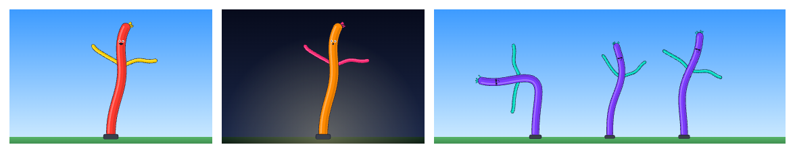

# Skydancer



**[Try it live](https://marjanb.github.io/skydancer/)** - tweak one and copy its embed code.

An animated inflatable tube man as an embeddable web widget. It is transparent, has no dependencies, and pauses itself while scrolled out of view. The dancer leans toward the mouse pointer and gets blown around by random gusts.

## Embed

```html
<script src="https://cdn.jsdelivr.net/gh/marjanb/skydancer@2/skydancer.min.js"></script>
<sky-dancer color="#7d3cff" accent="#00e0c6" face="cool" style="height: 500px"></sky-dancer>
```

The widget is 400px tall by default and crops to the dancer: its width follows its height (1.4x, plus a little per extra dancer), so it sits inline like an image rather than filling the page. Size it with CSS -- set the height and the width follows, or set both to override the crop. The dancer scales with the height and keeps its proportions.

| Attribute    | Default   | Meaning                                    |
|--------------|-----------|--------------------------------------------|
| `color`      | `#ff3b30` | body colour                                |
| `accent`     | `#ffd60a` | arms and hair colour                       |
| `girth`      | `64`      | body thickness (px at 1000px widget height) |
| `arm-length` | `0.32`    | arm length as a fraction of body height    |
| `speed`      | `1`       | animation speed                            |
| `wildness`   | `1`       | how much it flails                         |
| `wind`       | `1`       | wind strength; `0` is calm. Scales the gusts, the pointer, and the page scrolling past |
| `hours`      | none      | when it is worth dancing, as `9-17`; `22-6` runs through midnight. Outside them the air is out and the dancer lies flat |
| `face`       | `happy`   | `happy`, `surprised`, `cool`, `wink`, `joy`, `sleepy` or `angry` |
| `pattern`    | `none`    | markings on the body: `none`, `rings` or `spiral` |
| `hair`       | `true`    | `false` hides the hair                     |
| `count`      | `1`       | how many dancers stand together (max 6)    |
| `variety`    | `false`   | `true` gives each dancer in a crowd its own colour, face, girth, arms and hair |
| `paused`     | `false`   | `true` holds the pose; the dancer stays on show, it just stops |
| `sign`       | none      | words in a speech bubble; divide several with `\|` and it works through them, 4s each. `\|\|` is a literal pipe |
| `print`      | none      | words printed down the body, bending with the tube |
| `placard`    | none      | words on a board staked at the dancer's feet, which hold still |
| `shout`      | none      | what it blurts when poked; the word pops up beside it and fades, leaving the sign alone. Divide several with `\|` (and `\|\|` for a literal one) and a poke takes one |
| `bubble`     | `drawn`   | bubble shape: `drawn`, `box` or `burst`    |
| `href`       | none      | where a click on the dancer leads, in a new tab; it also becomes a link that can be tabbed to |

The `sign` attribute puts words in a hand-drawn speech balloon beside the dancer's head. It drifts rather than tracking the head, so the words stay readable.

The canvas is marked `aria-hidden`, since it is decoration. The sign's words
are mirrored into a visually hidden element, so a screen reader, the page's own
find and a translator can all reach them.

## Theming from CSS

Leave `color` or `accent` off the tag and the dancer takes them from custom
properties instead, so a page can dress it from its own stylesheet and follow a
light and a dark scheme without the embed being rewritten:

```css
:root { --sky-dancer-color: #15803d; --sky-dancer-accent: #d7f000; }
```

An attribute wins over a custom property, and an unreadable value falls back to
the default. The widget rereads them when the colour scheme changes, when
`<html>` gains or loses a class or `data-theme`, and when a colour attribute is
set, so a theme toggle reaches the dancer either way.

## Scripting

```js
document.querySelector('sky-dancer').cheer();     // set it flailing
document.querySelector('sky-dancer').deflate();   // flop
document.querySelector('sky-dancer').inflate();   // stand back up
```

`cheer()` gives the same burst a poke does, for a page with something to
celebrate. It does nothing on a dancer that is off screen or holding a still
pose for `prefers-reduced-motion`, rather than saving the flail up.

`deflate()` and `inflate()` are the other half: a dancer that sags when
something goes wrong and rises when it comes right. It stays on show either
way — a mood, not `hide()` and `show()` — and one left down stays down, even
if it scrolls out of view and back. A held pose takes the change at once
instead of breathing into it.

The page's own scroll is what counts: a dancer inside a scrolling container, or in an iframe whose parent is what scrolls, is not blown by it. A jump to an anchor or to the end of the page reads as one gust rather than as the distance travelled, and a reflow above the viewport can stir it as a scroll would.

`hours` is read from the reader's own clock, not the shop's, so a visitor in another timezone sees their own hours. The page may still call `deflate()` or `inflate()` in between, and the next check puts it back where the hours say within the minute.

To show and hide a dancer, call `hide()` and `show()` on the element, or set the standard `hidden` property:

```js
document.querySelector('sky-dancer').hide();
```

A hidden dancer stops animating and costs nothing until it is shown again.

Poking a dancer knocks the air out of it. Where the viewer's system asks for reduced motion, it holds a still pose instead of animating.

## Customizer

Open `index.html` to tweak a dancer with sliders and copy its embed code. `embed-example.html` shows several dancers on one page.

## License

MIT, see [LICENSE](LICENSE).
